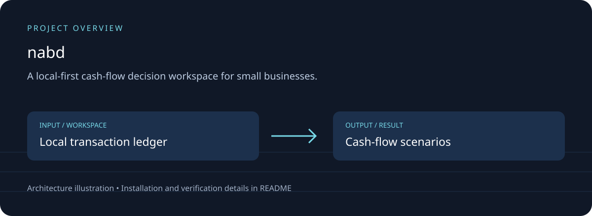
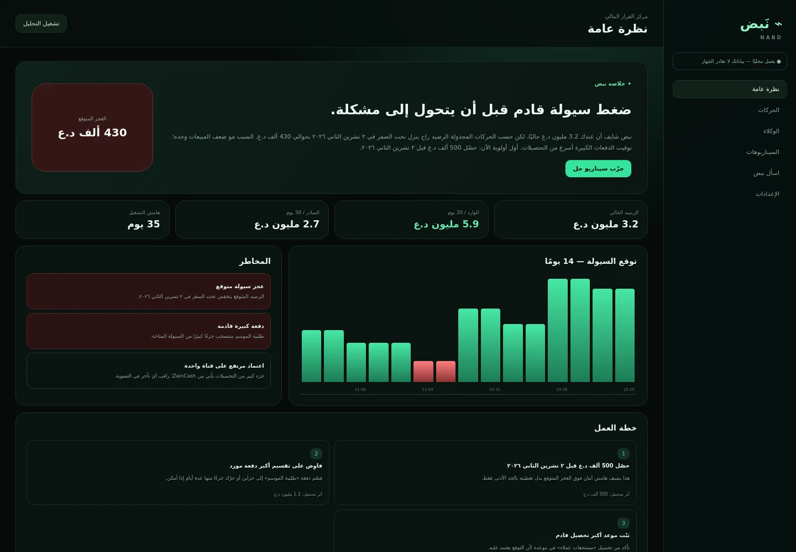

# نَبض | NABD

## Download, setup and project overview

A local-first cash-flow decision workspace for small businesses.

CSV transactions; cash-flow analysis; scenario comparisons; local Arabic explanations; offline assets.



### Running application



Actual local browser capture from this maintenance pass; a screenshot alone does not verify every feature.

[Download source ZIP](https://github.com/ahpa5246-lgtm/nabd/archive/refs/heads/main.zip) · [Changes and branches](https://github.com/ahpa5246-lgtm/nabd/branches) · [Verification notes](docs/QUALITY_REVIEW.md)

The ZIP contains source code. Installation steps and external runtime requirements are listed below.

```bash
git clone https://github.com/ahpa5246-lgtm/nabd.git
cd nabd
```

From the repository directory:

```text
python -m http.server 8080 --bind 127.0.0.1
# Open http://127.0.0.1:8080
```

The diagram is a project illustration. Test results and runtime limitations are recorded in [the review](docs/QUALITY_REVIEW.md); it is not a production-readiness certification.


نَبض هو مساعد قرار مالي Local-first للتجار والمشاريع الصغيرة. يجمع الحركات المالية من CSV، يحسب التدفق النقدي، يتوقع الضغط على السيولة، ثم يمرر النتيجة عبر شبكة من الوكلاء المتخصصين بدل الاعتماد على نموذج واحد غامض.

## ما الذي يقدمه؟

- **Observer Agent** لتنظيف الحركات وتوحيدها.
- **Cashflow Agent** لحساب الرصيد الحالي وتوقع 14 يومًا.
- **Risk Agent** لاكتشاف العجز، الدفعات الكبيرة، وتركيز قنوات التحصيل.
- **Reasoning Agent** لتحديد السبب الأقرب للمشكلة.
- **Planning Agent** لبناء إجراءات ذات أثر مالي واضح.
- **Explainer Agent** لتحويل النتيجة إلى لغة عربية بسيطة.
- مختبر **What-if** لتجربة التحصيل الإضافي، خفض المصروفات، أو تأجيل دفعة قبل تنفيذ القرار.
- مساعد أسئلة محلي يعمل بدون API.
- استيراد CSV، قالب CSV جاهز، وتصدير Backup/Report.
- حفظ محلي في المتصفح، بدون رفع البيانات المالية إلى خادم خارجي.
- PWA قابلة للتثبيت وتعمل Offline بعد الزيارة الأولى.

## التشغيل

لا يحتاج المشروع إلى npm أو build step. شغّله بأي static server، مثل:

```bash
python -m http.server 8080
```

ثم افتح `http://localhost:8080`.

## النشر

### Render Static Site
- Build command: اتركه فارغًا
- Publish directory: `.`

يوجد أيضًا `render.yaml` جاهز.

يمكن نشر المشروع كذلك على GitHub Pages أو Netlify أو Cloudflare Pages أو أي استضافة Static.

## CSV المتوقع

```text
date,amount,type,category,description,channel,status
```

- `type`: `income` أو `expense`
- `status`: `completed` أو `scheduled`
- `channel`: `cash` أو `zaincash` أو `bank` أو `other`

## الخصوصية

هذه النسخة Local-first: التحليل والحفظ يتمان داخل المتصفح. لا توجد حسابات مستخدمين أو مزامنة سحابية افتراضيًا، وهذا مقصود لتقليل تكلفة التشغيل وتجنب إرسال البيانات المالية الحساسة.

نَبض أداة دعم قرار ولا يقدم استشارة محاسبية أو استثمارية أو قانونية. يجب مراجعة صحة البيانات والافتراضات قبل اتخاذ قرارات مالية جوهرية.

## مسار التحويل إلى SaaS

النسخة الحالية صالحة كـ MVP تجاري أو Pilot. عند الحاجة إلى تعدد المستخدمين والمزامنة يمكن إضافة Auth + PostgreSQL/Supabase مع إبقاء محرك الوكلاء الحالي، ثم إضافة موصلات ZainCash أو المصارف عندما تتوفر APIs واتفاقيات وصول رسمية.

## الترخيص

All Rights Reserved. راجع [LICENSE](./LICENSE).

